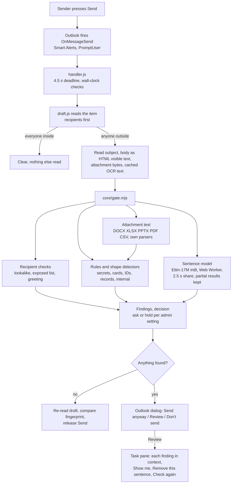

# Architecture

Disclosure Gate for Outlook is a folder of static files. There is no server, no account and no hosted
model: every check runs inside Outlook on the sender's computer, and nothing in an email is sent anywhere
to be checked. This document explains how a Send flows through it and why it is built this way.
`SPEC.md` is the behavioural contract; this file is the map.

## A Send, end to end

Earlier, while the sender is still writing, two compose-time events do the slow work in advance: the
attachment-changed event reads pictures and scanned PDFs with on-device OCR, and the compose event
loads the sentence model from the browser's cache. Send then only has to check.

## Layers

| Layer | Files | What it owns |
| --- | --- | --- |
| Core | `core/*.mjs` | Every decision. Pure functions over a draft snapshot: no Office, DOM or network APIs, so the same code runs in Node tests, the browser and the classic Outlook engine. |
| Extractors | `core/extract/*.mjs` | Own bounded readers for ZIP, inflate, XML, Office documents and PDF. Linear time, hard size limits, fail closed: a file it can't read is a finding, never a silent pass. |
| Outlook adapters | `outlook/handler.js`, `outlook/draft.js` | The Send event, Office API calls (at most three in flight), deadlines, result storage for the pane. Plain ES2016 so classic Outlook can run them. |
| Local services | `outlook/model-service.mjs`, `outlook/ocr-service.mjs` | The model and OCR workers: verified asset loading, budgets, cancellation, chunked classification. Optional by design: if either is missing or late, rules still decide. |
| Task pane | `outlook/taskpane.mjs`, `outlook/pane-logic.mjs` | Review UI: findings in context, sentence removal that edits only that sentence's characters, re-check. |
| Setup | `outlook/setup.mjs`, `outlook/manifest*.mjs` | A client-side page that generates the admin's manifest. Settings live only in the manifest's URLs. |

## Design decisions

**Rules decide; the model adds.** Deterministic rules and shape detectors (Luhn, IBAN checksums, ABA
routing, SSN ranges, token prefixes, look-alike character folding) cover what has a checkable shape.
The model only adds findings on sentences the rules did not already flag, and a missing, slow or broken
model can never remove or change a rule finding.

**Fail toward the sender, not toward silence.** Every failure (unreadable file, timeout, changed draft,
OCR still running) is reported as a finding under the admin's failures setting. The default asks with
Send anyway; IT can choose to hold. A clear result is released only after re-reading the draft and
matching its fingerprint, so an edit made during the check is never sent unchecked.

**One codebase, three engines.** Outlook on the web and the new Outlook run a browser runtime; classic
Outlook for Windows runs a JavaScript-only engine without modern regular expressions. The build compiles
named-group patterns into a lookup table for the classic engine (`outlook/indexed-pattern.mjs`), and a
test proves both engines return identical findings and highlights. Built scripts are pure ASCII, so a
host that serves them without a charset cannot corrupt a pattern.

**The model is small on purpose.** Ettin-17M (MIT), quantised to int8 (17 MB), runs in a Web Worker
with onnxruntime-web WASM on one thread. Assets are fetched from the add-in's own origin, verified by
SHA-256 against a build-time manifest, and cached; email text is never cached. At Send it gets 2.5 s of
the 4.5 s deadline, classifies sentences 16 at a time in email order, and keeps whatever it finished if
time runs out. Each sentence is read with the one before it, and a flag that spills onto the next
sentence is re-checked on its own.

**Recipients are evidence, not identity.** Lookalike domains are compared on the registrable name with
look-alike characters folded (`north1ine.com`, Cyrillic letters, `*.onmicrosoft.com` tenant names). A
greeting that names nobody on the recipient lines asks, but only when every To recipient has a first
name to compare; role mailboxes, groups and bare addresses that are not name-shaped stay quiet.

**What the sender sees is plain.** Dialogs name the finding and where it is, never the secret value.
Copy is a frozen table (`core/copy.mjs`) linted by tests for tone. The pane shows the actual sentence,
because the sender is the one person entitled to see it.

## Testing

`npm test` builds the add-in and runs 340+ tests in Node: the core on synthetic drafts, both built
runtimes in a VM with Outlook's quirks reproduced (Outlook on the web replaces
`String.prototype.startsWith`; its plain-text body joins lines), the model service against a fake
worker, the pane's state machine, and the manifest. Accuracy is measured separately on held-out sets;
see [EVALUATION.md](EVALUATION.md).

## What is deliberately not here

No hosted inference, no telemetry, no logging of content, no account, no settings a user can write that
widen what counts as inside, and no network access from the add-in beyond loading its own static files.
