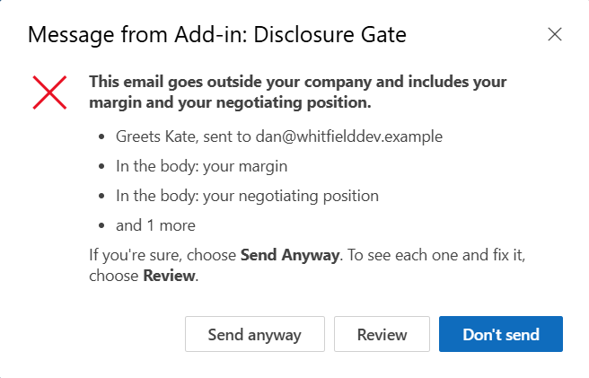
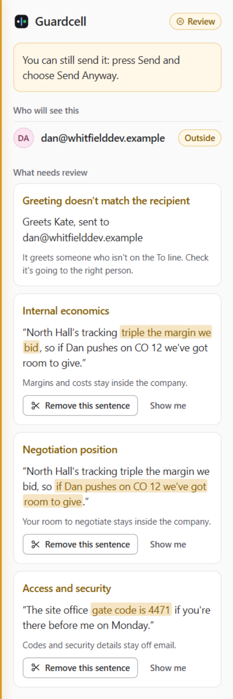

# Guardcell for Outlook

**An Outlook add-in that asks "are you sure?" before an email takes something sensitive outside your
organization.** Press Send and, if the email carries a password, a card number, a spreadsheet of
people's details, your margin or a remark about a client, or looks like it is going to the wrong
person, Outlook shows what it found and where. The sender chooses Send Anyway, Review or Don't Send.

Everything runs inside Outlook on the sender's own computer: rules, attachment readers, on-device OCR
and a small on-device language model. There is no server, no account, no AI service, no telemetry and
no log. Nothing in an email is sent anywhere to be checked.

**Set it up:** https://jamesdimachkie.github.io/guardcell-outlook/ ·
[How it works](ARCHITECTURE.md) · [How it was tested](EVALUATION.md) · [Spec](SPEC.md)

&nbsp;

*A fictional email written to Kate but addressed to the client, on Send in Outlook on the web (left),
and the Review pane it opens (right).*

## What it catches

| | |
| --- | --- |
| Passwords, keys and codes | A password or PIN that is actually given, a login with its password, API keys and tokens (AWS, GitHub, Slack, Stripe, Google, OpenAI, Anthropic), private keys, JSON Web Tokens, database connection strings, and door, gate, alarm or Wi-Fi codes |
| Card and bank details | Luhn-valid card numbers, valid IBANs, US routing numbers with an account number, UK sort codes with an account number |
| Government ID numbers | US Social Security, UK National Insurance and Canadian SIN numbers; passport, license and personal tax ID numbers |
| Lists of people's details | A spreadsheet, table, form or sentence that pairs people with what is sensitive about them: home addresses, ID or tax numbers, health, offences, pay, family members, claims |
| What it means, not just what it says | Personal details about someone, your own costs and margins, your negotiating position, insults, and physical security (a hidden key, an alarm left off), in wordings rules miss, read by an on-device model |
| Wrong recipient | A greeting to someone who isn't on the recipient lines ("Hi Alex," sent only to Morgan Vale), and addresses that look like yours but aren't (`north1ine.com`) |
| Marked internal | "Internal only", "not for external distribution", "don't forward this to the client" in an email going outside |
| Exposed recipient lists | Eight or more outside addresses from three or more organizations in To and Cc |
| Attachments and pictures | Word, Excel, PowerPoint, PDF, CSV and text files use local parsers; supported PDF image pages and embedded Office pictures also receive on-device OCR. Incomplete coverage asks or holds; unreadable pictures ask. Micro-images and scan limits are described below |

Email that stays inside your organization is never held. Meeting invitations are checked the same way.

## How well it works

**On real mail.** 2,000 outside emails that Enron employees sent in 1999–2002 (the public CMU corpus),
from mailboxes never used in development, read in full by labelers who could not see which system had
asked:

| | Serious disclosures caught | Emails asked about | Asked about needlessly |
| --- | --- | --- | --- |
| Rules, recipients and the on-device model v2.3 (default) | **61** | 700 (35%) | 559 (28%) |
| Rules and recipient checks only (model off) | 19 | 53 (2.7%) | 26 (1.3%) |

"Serious" means a disclosure that could plausibly cause harm if it reached the wrong eyes: credentials or
account details, internal costs and negotiating limits, a third person's health, family or legal
situation, a disparaging remark about a business contact. The labelers found 62 such emails among those
any system asked about; a random sample of the rest suggests about 34 more that nothing asked about. So
on this mail the default asks about one email in three and catches roughly two serious disclosures in
three. It is tuned that way on purpose: a needless question costs one click, a missed disclosure can
cost a client, a fine or a career. Enron's mail is heavy with personal chatter and forwarded chain
letters; ordinary business mail is likely to be asked about less, but that has not been measured. A
second, fresh sample of 2,000 emails from the same held-out mailboxes gave the same picture: 32% asked
about, 40 serious disclosures caught against the rules' 12.

**On blind synthetic sets** written to be hard (disclosures implied, buried in threads, given as bare
numbers, casual or regional English), by AI models that wrote none of the training data and scored once
against bars fixed in advance: 108 of 120 disclosures caught on the newest set, `everyday7`, questioning
53 of its 400 deliberately messy ordinary emails; 101 of 120 and 9 of 398 on the one before. On 49 real,
documented email incidents rebuilt with invented names, it asks about 35.

[EVALUATION.md](EVALUATION.md) has the method, every gate including the ones that failed, and the
limits. Four attempts to make it ask less were rejected: a retrained v2.4 and two calmer settings (one
asked 43% less often) each missed serious disclosures v2.3 catches, and a larger 32M model did no
better on development mail.

Attachments: 36 everyday documents saved by Chromium and Microsoft Word, as PDF and `.docx`, all read
in full with every amount, name and accented or non-Latin phrase intact
([evaluation/everyday-docs](evaluation/everyday-docs/)). On 1,008 Mozilla pdf.js PDFs and 578 Apache
POI Office files, regression collections built to break parsers, each file runs in its own bounded
process: no crashes or timeouts, and the slowest check took 1.41 seconds (OCR inference excluded).
A file that can't be read completely is reported as can't-check and asks, instead of passing on what
was read; in all, 621 of the PDFs and 107 of the Office files come back can't-check (73 and 16 net
more than an earlier reader, reproduced from its archived source), and 55 Office files go to
OCR for their embedded pictures. Neither collection measures accuracy on ordinary mail.
Outcomes, provenance and the command are in [DEVELOPMENT.md](docs/DEVELOPMENT.md#public-attachment-corpus-check).

PDF image-only pages and images beside native text require OCR, which is combined with native page,
form and annotation text. The bounded scan reader supports JPEG and simple raw/Flate RGB/gray images,
up to 12 PDF pages, 12 images and 12 megapixels. Unsupported rendering (including masks, clipping,
painting, inline images and image-bearing annotations) follows the failures setting. Unmapped PDF
text runs, Type3 glyph programs, tiling patterns and forms nested beyond eight levels also make the
file can't-check. Text drawn only as vector outlines is outside the native reader's coverage.
Office pictures, including those in embedded Office files, use the attached-picture rule: unavailable
or failed recognition asks with Send Anyway; pending OCR, changed bytes, API/identity errors,
timeouts and cache limits follow the failures setting.
Native document text is checked in either case. Office pictures share a 12-image/12-megapixel limit;
only micro-images up to 8×8 pixels and 256 bytes, and cached package thumbnails, are ignored. Larger
logos may contain words. Referenced thumbnails are checked too. SVG text is read natively; SVG
embedded images and unsupported picture formats ask, as do Office picture-count/pixel overflows. XML depth/work
limits fail closed. See [SPEC §6](SPEC.md#6-attachments) for the exact limits. OCR requires a capable
runtime, runs in English on the device, and never replaces native document validation.

The model runs in Outlook on the web, the new Outlook for Windows and Outlook for Mac; classic Outlook
for Windows uses the rules alone. IT can switch the model off at setup, or adapt it to their own
mail ([docs/ADAPTING.md](docs/ADAPTING.md)).

## Install

A Microsoft 365 admin installs it once; users do nothing.

1. Open the [setup page](https://jamesdimachkie.github.io/guardcell-outlook/setup.html),
   choose **When it finds something: Ask or Hold** and **When it can't check: Ask or Hold**.
   Both default to **Ask**, recommended for most teams. Hold is for teams whose policy requires it.
   Add your other internal domains and download `manifest.xml`.
2. In the Microsoft 365 admin center, go to Settings > Integrated apps > Upload custom apps and
   upload the manifest.
3. Assign users or groups. Microsoft can take up to a day to deliver it to Outlook.

If something doesn't behave as expected, see [Troubleshooting](docs/TROUBLESHOOTING.md).

To host the files yourself, build them (`npm ci && npm run build`), serve `dist/` over HTTPS, and
enter that address on the setup page.

Both Ask settings generate `PromptUser`. Findings=Hold with failures=Ask generates `SoftBlock`;
failures=Hold generates `Block`. Ask outcomes use a `promptUser` override on Mailbox 1.14+.
Older clients hold those outcomes too in a SoftBlock or Block installation.
Exposed recipient lists and attached pictures it couldn't read always ask where supported. Legacy
URLs `mode=warn` and `mode=enforce` map to ask/ask and hold/hold; explicit new settings refine them.

If the add-in cannot load, failures=Ask leaves the sender Outlook's Send Anyway / Try Later choice,
including when findings=Hold. Files it can't read and checks that don't finish can still be sent
after the sender confirms; choose Hold for failures too to prevent that. Failures=Hold installs
Block and holds on load failure. See [Microsoft's modes and unavailable-add-in behavior](https://learn.microsoft.com/en-us/office/dev/add-ins/outlook/onmessagesend-onappointmentsend-events).
The runtime override from a SoftBlock manifest still needs live-client verification.
If the runtime can't recover valid settings, only the mailbox domain counts as inside and the
dialog uses conditional instructions because Outlook's installed mode determines the buttons.

### Make Hold settings work everywhere

These policies matter when **either setting is Hold**. Outlook decides some cases before the
add-in runs. For holding to cover them, also set:

| Client | Setting | Without it |
| --- | --- | --- |
| Outlook on the web, new Outlook for Windows | `OnSendAddinsEnabled` on the users' OWA mailbox policy (Exchange Online PowerShell: `Set-OwaMailboxPolicy <policy> -OnSendAddinsEnabled:$true`) | Mail sent while Outlook started offline isn't checked |
| Outlook for Mac | `OnSendAddinsWaitForLoad` = true in the `com.microsoft.outlook` domain (through your Mac management tool) | Mail can be sent before the add-in has loaded |
| Classic Outlook for Windows | Group Policy *Running Outlook for Simple MAPI Mail Sending* = Enabled | Word's "Attach a copy", "Send to mail recipient" and similar can send while Outlook is closed, unchecked |

Microsoft's reference: [Smart Alerts behavior](https://learn.microsoft.com/en-us/office/dev/add-ins/outlook/onmessagesend-onappointmentsend-events).

### What it doesn't see

- **Meeting exclusions**: invitations and updates from the organizer form are checked. In web/new Outlook, sends from embedded meeting forms and meeting forwards don't trigger the check; use a separate window. Meeting forwards and attendee responses aren't covered on any client. Resources not exposed in attendee lists or enhanced locations, including personal contact groups used as locations, aren't visible.
- **Protected items**: Outlook doesn't run add-ins on items whose sensitivity label or IRM template turns off programmatic access, so those are sent unchecked.
- **Changes after Send**: Exchange rules that forward, redirect or copy mail outside, or add server-side signatures, act after the check. An inside address that reaches outsiders (a Microsoft 365 group with guests) counts as inside.
- **Phones, other apps and scripts**: Outlook on iOS and Android doesn't run Send checks; mail sent by other apps or services isn't checked.

The sentence model is on unless IT turns it off. Classic Outlook for Windows uses rules only. Other clients skip it
if browser capabilities are missing, it is not ready in time, or there are more than 400 readable
sentences. Model failure never fails the check: rules still run over the full text. The model has
at most 2.5 seconds within Send's 4.5-second deadline; on a long email it keeps whatever it finished in time. Public assets are cached; email is not.
Compose preparation initializes a worker/session that repeat Sends reuse if that runtime survives.
A fresh Send runtime still verifies cached public files and initializes its own session. Timeouts
and OCR preemption terminate the worker. [Browser Send timings and their limits](docs/SEMANTIC-INTEGRATION.md#browser-send-timing).
The model reads each sentence with the one before it; an input beyond its 128-token window skips the model pass.
Live in Outlook on the web with the sideloaded v2 manifest, findings dialogs appeared in 0.31–0.46 seconds:
0.31 seconds for a model-only finding after compose preload and 0.42 seconds for an attached picture
after a 30-second wait. Picture pre-reading is inferred from timing; a true cold model download and
the other clients have not been measured live. [Live results and limits](outlook/RUNTIME-V2-NOTES.md#live-evidence-v2-manifest-outlook-on-the-web-24-october-2026).

Works in Outlook on the web, the new Outlook for Windows, classic Outlook for Windows (2206 or later)
and Outlook for Mac (new UI, 16.65 or later), with Exchange Online. Outlook on phones doesn't run Send
checks, and mail sent by other apps or scripts isn't checked. This installation is deployed by an
admin; it is not published in the Microsoft Marketplace.

## Development

Node 24. `npm ci`, then `npm test` (builds, then runs the offline suite) or `npm run dev` (serves
`dist/` at `https://localhost:3443`). Details: [docs/DEVELOPMENT.md](docs/DEVELOPMENT.md).

For model work: [adaptation guide](docs/ADAPTING.md), [training pipeline](model/train/README.md),
[published training data](model/data/README.md), and [gate pre-registrations](docs/gates/README.md).

## Security

See [SECURITY.md](SECURITY.md). Licensed under [Apache 2.0](LICENSE).

## Name

Guard cells are the pairs of cells around each pore on a leaf. Osmosis opens them for ordinary
exchange and closes them to keep in what the plant needs. Guardcell was called Disclosure Gate until
25 October 2026; dated records (gate plans, held-out set notes, live-run notes) keep that name.
